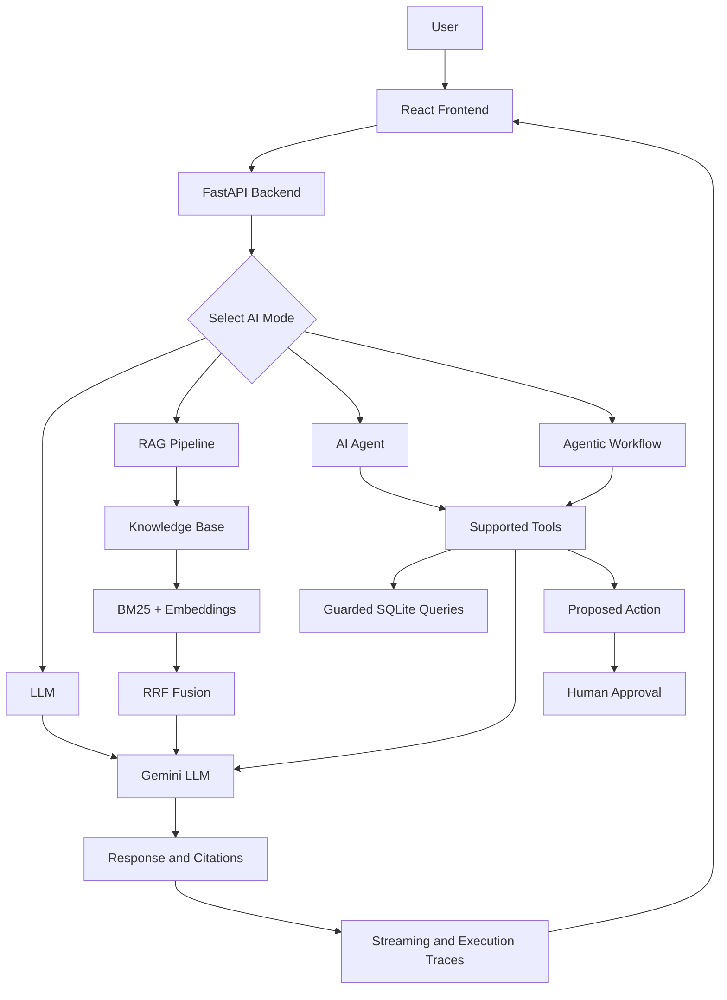

# 🛒 Support Copilot AI

**An AI-powered customer support and operations assistant built with LLMs, Retrieval-Augmented Generation (RAG), AI agents, and human-in-the-loop workflows.**

Support Copilot AI helps answer support questions, retrieve relevant policy information, analyze operational data, and propose actions with human approval.

It combines **Gemini, hybrid retrieval, tool calling, multi-agent workflows, and an interactive React dashboard** in one application.

---

## 📌 Table of Contents

- [Overview](#-overview)
- [Key Features](#-key-features)
- [AI Modes](#-ai-modes)
- [System Architecture](#-system-architecture)
- [Technology Stack](#-technology-stack)
- [Project Structure](#-project-structure)
- [Getting Started](#-getting-started)
- [Environment Configuration](#-environment-configuration)
- [Testing](#-testing)
- [Security and Guardrails](#-security-and-guardrails)
- [Deployment](#-deployment)
- [Limitations](#-limitations)
- [Future Improvements](#-future-improvements)

---

## 🎯 Overview

Customer support systems often need to handle repetitive queries, search through policy documents, investigate operational issues, and recommend corrective actions.

Support Copilot AI explores how these workflows can be assisted by combining language models with retrieval, database tools, and approval-based automation.

The application provides four AI interaction modes:

1. **LLM:** Generates responses using a language model.
2. **RAG:** Retrieves relevant information from a knowledge base before answering.
3. **AI Agent:** Uses tools to investigate questions and retrieve relevant information.
4. **Agentic AI:** Supports more structured, multi-step workflows involving multiple agents or tools.

The project also includes an operations dashboard, execution traces, run history, feedback, and an approval workflow.

> **Important:** This is an independent demonstration project. It is not an official Blinkit product and does not connect to Blinkit's production systems.

---

## ✨ Key Features

| Feature | Description |
|---|---|
| 🤖 Multiple AI modes | Compare LLM, RAG, AI Agent, and Agentic AI workflows. |
| 📚 Hybrid RAG | Combines BM25 keyword retrieval and embedding-based retrieval using Reciprocal Rank Fusion (RRF). |
| 📄 Policy citations | Uses retrieved policy content to support answers with relevant references. |
| 🧰 Tool calling | Allows agents to invoke supported tools for information retrieval and analysis. |
| 🧠 Multi-agent workflows | Supports coordinated, multi-step agent-based processing. |
| 📊 Operations analytics | Provides operational data and analytics through the dashboard. |
| 🛡️ Human approval | Routes proposed actions through an approval workflow instead of executing them automatically. |
| 🔎 Execution traces | Displays workflow activity and supports investigation of agent runs. |
| 💬 Run history and feedback | Supports reviewing previous runs and recording feedback. |
| ⚡ Streaming responses | Uses Server-Sent Events (SSE) for streaming workflow updates. |
| 🐳 Containerization | Includes Dockerfiles and Docker Compose configuration. |
| 🧪 Automated checks | Includes backend tests, evaluation assets, and a GitHub Actions workflow. |

---

## 🧩 AI Modes

| Mode | How it works | Best suited for |
|---|---|---|
| **LLM** | Generates an answer directly using the configured language model. | General questions and conversational responses. |
| **RAG** | Retrieves relevant knowledge-base content and uses it to generate a grounded answer. | Policy questions and document-based support. |
| **AI Agent** | Uses available tools to gather information and work through a request. | Operational queries requiring tool usage. |
| **Agentic AI** | Coordinates a more structured workflow involving multiple steps, tools, or agents. | Complex support and operational investigations. |

These modes represent different approaches to AI-assisted support, from direct generation to retrieval and tool-driven workflows.

---

## 🏗️ System Architecture



### Request lifecycle

1. The user submits a question or operational request through the frontend.
2. The backend processes the request according to the selected AI mode.
3. The RAG pipeline retrieves relevant knowledge when required.
4. Agents use supported tools to gather information when appropriate.
5. The language model generates a response based on the available context.
6. Results, citations, and execution traces are returned to the interface.
7. Proposed actions enter the approval workflow before any separately implemented execution step.

---

## 🛠️ Technology Stack

| Layer | Technologies |
|---|---|
| Frontend | React, Vite, JavaScript, CSS |
| Backend | Python, FastAPI |
| Language model | Google Gemini |
| Retrieval | BM25, embeddings, Reciprocal Rank Fusion |
| AI orchestration | Tool calling, agent workflows |
| Data storage | SQLite |
| API communication | HTTP APIs, Server-Sent Events (SSE) |
| Testing | Pytest, evaluation scripts |
| CI/CD | GitHub Actions |
| Containerization | Docker, Docker Compose |
| Deployment configuration | Render and Vercel configuration |

---

## 📁 Project Structure

```text
support-copilot-ai-agent-rag/
│
├── README.md
│
└── blinkit-copilot/
    ├── backend/
    │   ├── main.py
    │   ├── agents.py
    │   ├── analytics.py
    │   ├── config.py
    │   ├── db.py
    │   ├── llm.py
    │   ├── ops.py
    │   ├── queries.py
    │   ├── rag.py
    │   ├── tools.py
    │   ├── requirements.txt
    │   ├── Dockerfile
    │   ├── tests/
    │   ├── evals/
    │   ├── scripts/
    │   └── data/
    │
    ├── frontend/
    │   ├── src/
    │   ├── package.json
    │   ├── package-lock.json
    │   └── Dockerfile
    │
    ├── .github/
    │   └── workflows/
    │
    ├── docker-compose.yml
    ├── render.yaml
    └── .gitignore
```

*Note: This tree highlights the main components. Exact filenames and additional directories may vary with the repository version.*

---

## 🚀 Getting Started

### Prerequisites

Install the following before running the application:

- Python 3.10 or a compatible version supported by the project's dependencies
- Node.js and npm
- Git
- A Google Gemini API key
- Docker and Docker Compose (optional)

### 1. Clone the repository

```bash
git clone https://github.com/Tanvi-1496/support-copilot-ai-agent-rag.git
cd support-copilot-ai-agent-rag/blinkit-copilot
```

### 2. Configure the backend

```bash
cd backend
python -m venv .venv
```

Activate the virtual environment.

**Windows PowerShell:**

```powershell
.\.venv\Scripts\Activate.ps1
```

**Git Bash:**

```bash
source .venv/Scripts/activate
```

Install dependencies:

```bash
python -m pip install -r requirements.txt
```

Create a `.env` file in the `backend` directory and configure the required environment variables.

### 3. Start the backend

```bash
uvicorn main:app --reload
```

The backend will normally be available at:

- API: `http://127.0.0.1:8000`
- Interactive API documentation: `http://127.0.0.1:8000/docs`

### 4. Start the frontend

Open a second terminal:

```bash
cd blinkit-copilot/frontend
npm install
npm run dev
```

Open the local URL printed by Vite in the terminal, usually `http://localhost:5173`.

Keep the backend running while using the frontend. If the frontend requires a backend URL, configure it using the environment variable expected by the frontend code.

---

## 🔐 Environment Configuration

Keep API credentials in local environment files. Never commit actual credentials to GitHub.

Example `backend/.env`:

```dotenv
GOOGLE_API_KEY=your_google_api_key_here
```

Add other variables only if required by your implementation. Refer to the backend configuration and `.env.example` for the exact variable names and defaults.

**Before publishing:**

- Ensure `.env` files are excluded by `.gitignore`.
- Keep `.env.example` limited to placeholder values.
- Never include real API keys, database credentials, or private tokens.
- Rotate any credential that has accidentally been exposed.

---

## 🧪 Testing

Run the backend test suite from the `blinkit-copilot/backend` directory with the virtual environment activated:

```bash
pytest -q
```

To run the tests with more detailed output:

```bash
pytest -v
```

The repository also includes evaluation assets and scripts for checking aspects of the AI workflows.

For meaningful validation, test:

- Direct LLM responses.
- Retrieval relevance and policy-grounded answers.
- Tool invocation and database-query restrictions.
- Approval workflow behavior.
- Error handling and streaming responses.

Use the exact evaluation commands provided by the scripts in the repository.

---

## 🛡️ Security and Guardrails

Security is important when an AI system can access operational data or propose actions.

The project includes security-oriented design choices such as:

- **Read-only data access:** Supported database tools are designed for guarded, read-only queries.
- **Human-in-the-loop approvals:** Proposed actions are presented for review rather than being executed automatically.
- **Credential separation:** API keys belong in environment variables, not source code.
- **Traceability:** Execution traces help inspect workflow behavior.
- **Automated validation:** Tests and CI checks help identify regressions.

These controls reduce risk but do not guarantee complete security. Production deployment would require additional authentication, authorization, input validation, rate limiting, audit logging, monitoring, and security testing.

---

## ☁️ Deployment

The repository includes Docker and deployment configuration for running the application in containerized or hosted environments.

### Docker Compose

From the directory containing `docker-compose.yml`, run:

```bash
docker compose up --build
```

Stop the containers with:

```bash
docker compose down
```

Ensure required environment variables are configured and check the Compose file for the correct service ports before accessing the application.

### Hosted deployment

Render and Vercel configuration is included in the repository. Deployment requires configuring the correct backend and frontend build settings, environment variables, and service URLs.

**Deployment configuration does not necessarily mean a live deployment is available.** Add public demo links here once the frontend and backend have been deployed and verified.

- **Live Demo:** Add verified URL
- **API Documentation:** Add deployed API `/docs` URL
- **Repository:** [GitHub Repository](https://github.com/Tanvi-1496/support-copilot-ai-agent-rag)

---

## ⚠️ Limitations

- Response quality depends on the language model, retrieved context, and available tools.
- Retrieval results depend on knowledge-base coverage and relevance.
- SQLite is suitable for a lightweight demonstration but may not be sufficient for a high-concurrency production system.
- Human approval and read-only tool restrictions do not replace a comprehensive production security architecture.
- Live integrations and deployment availability depend on the configured environment.

---

## 🔮 Future Improvements

- Add authentication and role-based access control.
- Expand automated evaluation for answer quality and retrieval relevance.
- Improve observability with structured logs and latency metrics.
- Add more comprehensive audit trails for approval decisions.
- Introduce production-ready persistent storage and deployment monitoring.
- Add verified live-demo links and representative application screenshots.

---

## 👩‍💻 Author

**Tanvi Jaware**

B.Tech Information Technology

- GitHub: [Tanvi-1496](https://github.com/Tanvi-1496)
- Project: [Support Copilot AI](https://github.com/Tanvi-1496/support-copilot-ai-agent-rag)

---

<p align="center">
  <b>Support Copilot AI</b><br/>
  <sub>Exploring practical AI for customer support, knowledge retrieval, and operations.</sub>
</p>
