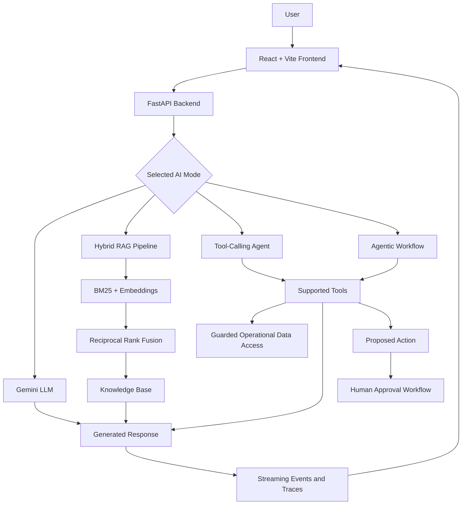

# 🛒 Support Copilot AI

**An AI-powered customer support and operations assistant built with Gemini, Hybrid RAG, tool-calling agents, and human-in-the-loop workflows.**

[](https://support-copilot-ai-agent-rag.vercel.app/)
[](https://support-copilot-api-ri27.onrender.com/api/health)
[](https://www.python.org/)
[](https://react.dev/)
[](https://fastapi.tiangolo.com/)
[](https://www.docker.com/)

Support Copilot AI demonstrates how large language models, knowledge retrieval, and tool-using agents can assist with customer support and operational workflows. It combines policy-grounded answers, operational data access, execution traces, analytics, and approval-based actions in a web application.

> **Project status:** Deployed demonstration application. This is an independent portfolio project and is not affiliated with, endorsed by, or connected to Blinkit's production systems.

## 🔗 Live Application

| Component | Link |
|---|---|
| Frontend | [Open Support Copilot AI](https://support-copilot-ai-agent-rag.vercel.app/) |
| Backend health check | [Check API health](https://support-copilot-api-ri27.onrender.com/api/health) |
| Interactive API documentation | [Explore API endpoints](https://support-copilot-api-ri27.onrender.com/docs) |
| Source code | [GitHub Repository](https://github.com/Tanvi-1496/support-copilot-ai-agent-rag) |

The application uses a React frontend deployed on Vercel and a FastAPI backend deployed on Render. Availability and response times depend on the hosting environment and configured external services.

## 📸 Application Screenshots


### 1. Application Dashboard


### 2. Agentic AI: Multi-Step Planning & Decision-Making

*Demonstrating coordinated tool usage, evidence-based decisions, duplicate-action checks, and human-in-the-loop approval.*


### 3. Agentic AI Execution & Traceability

*Real-time agent reasoning, tool execution, and step-by-step traceability.*


###  4. Agentic AI: Policy-Based Decision & Human Approval

The agent retrieves the applicable policy, checks the order's refund status, determines the eligible ₹150 goodwill credit, and queues the action for human approval. The wallet credit remains pending and has not been executed.


###  5. Hybrid RAG: Policy Retrieval & Grounded Answers

*Retrieving relevant policy evidence to generate accurate, source-backed responses.*


### 6. LLM: Contextual Answers & Customer Support Guidance

*Generating clear explanations and practical support guidance using a large language model.*


### 7. Operations Analytics: Orders, Refunds & Delivery Insights

*An operational overview of order volumes, late deliveries, refund payouts, unresolved support tickets, city-level delivery performance, product issue trends, membership comparisons, and dark-store refund rates.*


### 8. Conversation History & Session Tracking

*Maintaining conversation context and enabling users to review previous support interactions.*


## ✨ Key Features

- **Multiple AI interaction modes:** Explore direct LLM responses, Retrieval-Augmented Generation (RAG), tool-using AI agents, and agentic workflows.
- **Hybrid RAG pipeline:** Combines BM25 keyword retrieval with embedding-based retrieval and Reciprocal Rank Fusion (RRF).
- **Policy-grounded responses:** Retrieves relevant knowledge-base content to support answers with policy references.
- **Dynamic tool selection and chaining:** Enables an agent to select and sequence supported tools to investigate operational questions.
- **Operational data access:** Uses application tools to retrieve relevant order and support information.
- **Human-in-the-loop approvals:** Provides an approval workflow for proposed operational actions.
- **Streaming responses:** Uses Server-Sent Events (SSE) to stream agent events to the frontend.
- **Execution traces:** Records workflow activity to help inspect agent runs and investigate outcomes.
- **Analytics dashboard:** Presents operational metrics and insights.
- **Run history and feedback:** Supports reviewing agent activity and recording feedback.
- **Containerization:** Includes Docker configuration and Docker Compose support.
- **Automated checks:** Includes backend tests, evaluation assets, and GitHub Actions workflow configuration.

## 🧠 AI Interaction Modes

| Mode | Description | Example use case |
|---|---|---|
| **LLM** | Generates a response directly using the configured language model. | General conversational responses |
| **RAG** | Retrieves relevant knowledge before generating a response. | Answering questions about support policies |
| **AI Agent** | Selects and chains available tools to investigate a specific goal. | Checking an order and determining applicable compensation |
| **Agentic AI** | Supports more structured, multi-step workflows. | Complex support investigations and coordinated tasks |

The available capabilities depend on the selected mode, configured tools, and execution level. Multi-agent team delegation is distinct from single-agent tool chaining and requires the appropriate execution level.

## 🏗️ System Architecture



### Request lifecycle

1. A user submits a question or operational request through the frontend.
2. The FastAPI backend processes the request using the selected AI mode.
3. The RAG pipeline retrieves relevant knowledge when required.
4. The agent selects and invokes supported tools when the task requires additional information.
5. The language model generates a response using the available context and tool results.
6. The frontend receives streamed events, the final response, and relevant execution details.
7. Proposed operational actions can be routed through the approval workflow.

## 🛠️ Technology Stack

| Layer | Technologies |
|---|---|
| Frontend | React, Vite, JavaScript, CSS |
| Backend | Python, FastAPI |
| Language model | Google Gemini |
| Retrieval | BM25, embeddings, Reciprocal Rank Fusion |
| Agent orchestration | Tool calling, multi-step agent workflows |
| Database | SQLite |
| API communication | HTTP, Server-Sent Events |
| Testing | Pytest, evaluation scripts |
| CI/CD | GitHub Actions |
| Containerization | Docker, Docker Compose |
| Frontend hosting | Vercel |
| Backend hosting | Render |

## 📁 Project Structure

```text
support-copilot-ai-agent-rag/
├── README.md
└── blinkit-copilot/
    ├── backend/
    │   ├── app/
    │   │   ├── main.py
    │   │   ├── agents.py
    │   │   ├── analytics.py
    │   │   ├── config.py
    │   │   ├── db.py
    │   │   ├── llm.py
    │   │   ├── ops.py
    │   │   ├── queries.py
    │   │   ├── rag.py
    │   │   └── tools.py
    │   ├── tests/
    │   ├── scripts/
    │   ├── evals/
    │   ├── data/
    │   ├── requirements.txt
    │   └── Dockerfile
    ├── frontend/
    │   ├── src/
    │   ├── package.json
    │   ├── package-lock.json
    │   └── Dockerfile
    ├── .github/
    │   └── workflows/
    ├── docker-compose.yml
    ├── render.yaml
    └── .gitignore
```

*This tree highlights the main components; additional files may exist in the repository.*

## 🚀 Getting Started

### Prerequisites

Install the following tools before running the project locally:

- Git
- Python 3.12 or a compatible version supported by the dependencies
- Node.js and npm
- A Google Gemini API key
- A Tavily API key if web search is enabled
- Docker Desktop (optional)

### 1. Clone the repository

```bash
git clone https://github.com/Tanvi-1496/support-copilot-ai-agent-rag.git
cd support-copilot-ai-agent-rag/blinkit-copilot
```

### 2. Configure the backend

Open a terminal in the backend directory:

```bash
cd backend
python -m venv .venv
```

Activate the virtual environment.

**Windows PowerShell**

```powershell
.\.venv\Scripts\Activate.ps1
```

**Git Bash**

```bash
source .venv/Scripts/activate
```

Install dependencies:

```bash
python -m pip install -r requirements.txt
```

Create a `.env` file in `blinkit-copilot/backend/` and configure the environment variables listed below.

### 3. Start the backend

From the `blinkit-copilot/backend/` directory, run:

```bash
uvicorn app.main:app --reload
```

The backend should be available at:

- API base URL: `http://127.0.0.1:8000`
- Health endpoint: `http://127.0.0.1:8000/api/health`
- Interactive API documentation: `http://127.0.0.1:8000/docs`

### 4. Configure and start the frontend

Open a second terminal:

```bash
cd blinkit-copilot/frontend
npm install
```

Create a `.env` file in the frontend directory:

```env
VITE_API_URL=http://127.0.0.1:8000
```

Start the development server:

```bash
npm run dev
```

Open the local URL printed by Vite, usually `http://localhost:5173`.

Keep the backend running while using the frontend.

## ⚙️ Environment Configuration

Configure the following variables according to the implementation and the services you intend to use.

### Backend: `blinkit-copilot/backend/.env`

```env
GOOGLE_API_KEY=your_google_api_key_here
TAVILY_API_KEY=your_tavily_api_key_here

GEMINI_MODEL=gemini-3.1-flash-lite
EMBED_MODEL=gemini-embedding-001

CORS_ORIGINS=http://localhost:5173
APP_API_KEY=
RATE_LIMIT_PER_MIN=20
AGENT_MAX_STEPS=8
```

- `GOOGLE_API_KEY`: credentials for the configured Gemini services.
- `TAVILY_API_KEY`: optional search-service credentials when web search is enabled.
- `GEMINI_MODEL`: configured generation model.
- `EMBED_MODEL`: configured embedding model.
- `CORS_ORIGINS`: allowed frontend origins.
- `APP_API_KEY`: optional shared API key for protected endpoints.
- `RATE_LIMIT_PER_MIN`: request rate limit per client.
- `AGENT_MAX_STEPS`: configured maximum agent steps.

Use the variable names and defaults defined by the project's configuration files. The values above are examples for local development, not production credentials.

### Frontend: `blinkit-copilot/frontend/.env`

```env
VITE_API_URL=http://127.0.0.1:8000
```

For the deployed frontend, `VITE_API_URL` should point to the deployed backend URL.

**Security notes:**

- Never commit `.env` files or actual API credentials.
- Keep `.env.example` files restricted to placeholders.
- Variables prefixed with `VITE_` are bundled into client-side code and must not contain private secrets.
- If `APP_API_KEY` is unset, the current backend authentication function does not enforce that shared-key check. Protected endpoints may therefore become publicly accessible.
- A public demo should contain no real customer data, private operational records, or sensitive credentials.

## 🧪 Testing

From `blinkit-copilot/backend/`, activate the virtual environment and run:

```bash
pytest -q
```

For detailed test output:

```bash
pytest -v
```

The repository also includes evaluation assets and scripts for validating AI workflows. Review the available tests and evaluation scripts for their specific coverage.

Recommended areas to validate:

- LLM response generation
- Retrieval relevance and policy-grounded answers
- Tool selection and chaining
- Guarded operational data access
- Approval workflow behavior
- Error handling and streaming responses

## ☁️ Deployment

### Frontend: Vercel

The frontend is deployed on Vercel.

1. Configure the frontend root directory as `blinkit-copilot/frontend`.
2. Select Vite as the framework preset.
3. Configure `VITE_API_URL` to point to the deployed backend.
4. Deploy the frontend and verify the browser can reach the backend.

### Backend: Render

The backend is deployed on Render.

1. Configure the backend service using the repository's deployment configuration.
2. Set the backend root directory and Docker build context according to the included Dockerfile and `render.yaml`.
3. Configure the required environment variables in the hosting dashboard.
4. Set `CORS_ORIGINS` to include the deployed frontend origin.
5. Verify the health endpoint and inspect the service logs.

### Docker Compose

From `blinkit-copilot/`, run:

```bash
docker compose up --build
```

Stop the services with:

```bash
docker compose down
```

Check `docker-compose.yml` for the configured ports and environment requirements.

## 🛡️ Security and Guardrails

The project explores several safety-oriented design practices:

- Environment-based credential configuration.
- Guarded database tools.
- Human review for proposed actions.
- Execution traces for workflow inspection.
- Request rate limiting.
- Automated testing and CI checks.

These measures do not guarantee production-grade security. Before using the system with sensitive data, implement and validate appropriate authentication, authorization, access controls, secure secret management, audit logging, and production monitoring.

AI-generated decisions should be verified against the relevant policy and operational records. A recommended action must not be treated as proof that a refund or other transaction was actually executed.

## ⚠️ Limitations

- Answer quality depends on model behavior, retrieved context, and tool availability.
- Retrieval quality depends on the coverage and relevance of the knowledge base.
- SQLite is intended for a lightweight demonstration and may not suit high-concurrency production workloads.
- Tool access and workflow capabilities depend on the selected execution mode and configuration.
- Approval workflows do not replace a complete authorization and transaction-control system.
- Hosted service availability and response latency depend on the deployment environment and external providers.
- This project is a demonstration, not an official customer support system.

## 🔮 Future Improvements

- Add robust authentication and role-based access control.
- Expand retrieval and response-quality evaluation.
- Improve observability, structured logging, and latency metrics.
- Strengthen audit trails for approvals and operational actions.
- Improve persistent storage and deployment resilience.
- Add representative screenshots and additional end-to-end tests.

## 👩‍💻 Author

**Tanvi Jaware**  
B.Tech in Information Technology

- **GitHub:** [Tanvi-1496](https://github.com/Tanvi-1496)
- **Project Repository:** [Support Copilot AI](https://github.com/Tanvi-1496/support-copilot-ai-agent-rag)
- **Live Demo:** [Open Application](https://support-copilot-ai-agent-rag.vercel.app/)

---

*Built to explore practical applications of LLMs, retrieval-augmented generation, AI agents, and operational automation.*
